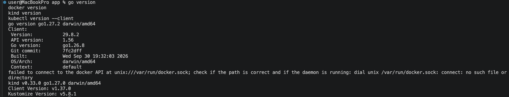
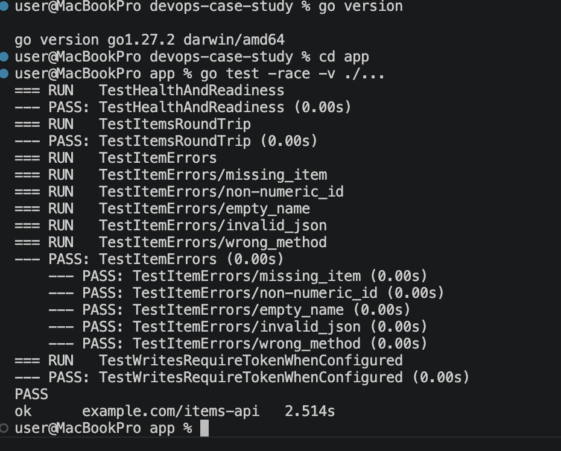
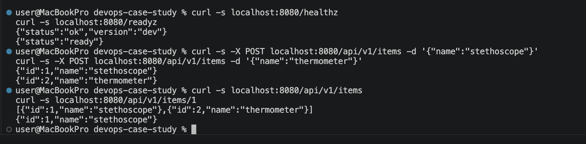
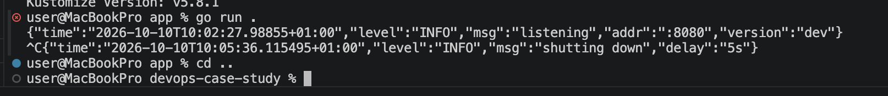
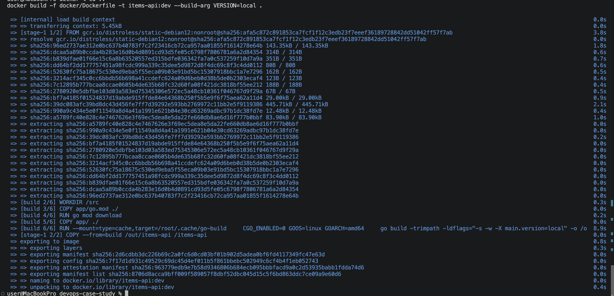
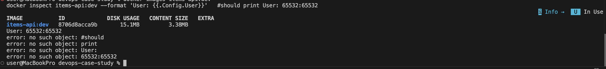
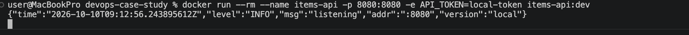
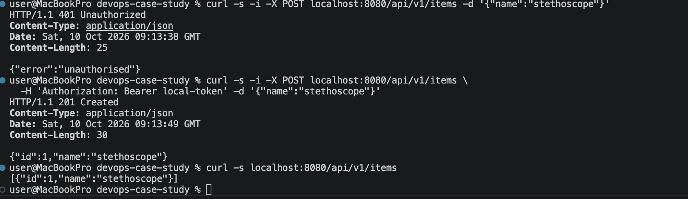
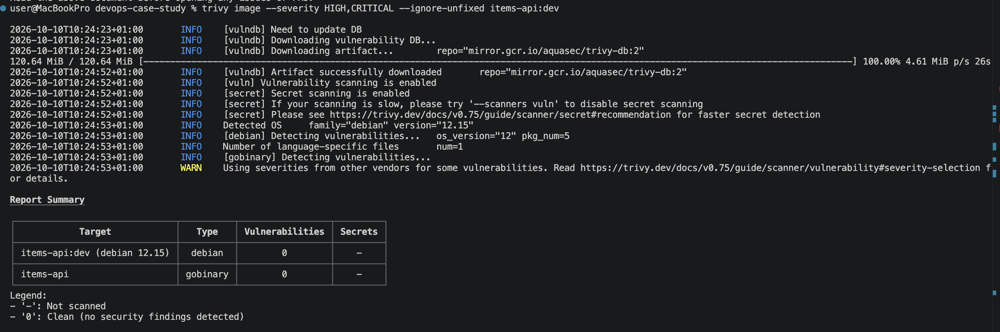

# Helium Health DevOps Engineer Case Study: Containerise, Build And Deploy A REST API To Kubernetes

## Aim of the Project

The purpose of this project is to onboard a new microservice to a platform. I wrote a small REST API, containerised it, built a CI pipeline for it with GitHub Actions, wrote the Kubernetes manifests to deploy it, and provisioned the supporting AWS infrastructure with Terraform.

The application is kept very simple on purpose. The focus is on the infrastructure and the pipeline around it.

## Requirements

+ Docker - To build and run the image locally.
+ Go 1.24 or newer - Only needed if you want to run the app or its tests outside Docker.
+ kubectl - A command line interface to interact with the Kubernetes cluster.
+ Terraform 1.10 or newer - To provision the AWS resources.
+ AWS CLI - To authenticate to AWS.
+ A Kubernetes cluster with the NGINX ingress controller installed and a CNI that enforces NetworkPolicy (for example Calico or Cilium).
+ kind 0.24 or newer - Only needed to run the Helm chart on a local cluster.
+ Helm 3.8 or newer - To install the app chart and Argo CD.

## Project Structure

```
.
├── app/                  # The Go REST API and its tests
├── docker/               # Dockerfile and its .dockerignore
├── .github/workflows/    # ci.yml (app and image) and terraform.yml
├── charts/items-api/     # Helm chart for the app
├── gitops/               # Argo CD values, the root app and the app definitions
├── terraform/
│   ├── bootstrap/        # State bucket and the pipeline's AWS roles (run by hand)
│   ├── modules/          # ecr, github-oidc-role, state-bucket, vpc, eks
│   └── *.tf              # Root config that uses the modules
└── README.md
```

## Running The Application Locally

There are three ways to run the service on a laptop. Each one builds on the one before it, and we can stop after any of them:

1. With Go - The quickest way to see the API working.
2. With Docker - Runs the same image the CI pipeline builds.
3. On a local Kubernetes cluster (kind) - Installs the real Helm chart from `charts/items-api`.

All commands are run from the root of the repository unless stated otherwise. On macOS, the tools can be installed with Homebrew:

```bash
brew install go kind kubectl
brew install --cask docker   #then open Docker Desktop from Applications

#confirm everything is installed
go version
docker version
kind version
kubectl version --client
```



### Option 1: Run With Go

1. First, we run the tests. All of them should show `PASS`.

    ```bash
    cd app
    go test -race -v ./...
    ```

    

2. Next, we start the app. It prints a JSON log line saying it is listening on `:8080` (see the screenshot in step 4). Leave this terminal open.

    ```bash
    go run .
    ```

3. In a second terminal, we call the API:

    ```bash
    #health and readiness
    curl -s localhost:8080/healthz
    curl -s localhost:8080/readyz

    #create two items
    curl -s -X POST localhost:8080/api/v1/items -d '{"name":"stethoscope"}'
    curl -s -X POST localhost:8080/api/v1/items -d '{"name":"thermometer"}'

    #list all items, then get one by id
    curl -s localhost:8080/api/v1/items
    curl -s localhost:8080/api/v1/items/1
    ```

    The expected output is:

    ```
    {"status":"ok","version":"dev"}
    {"status":"ready"}
    {"id":1,"name":"stethoscope"}
    {"id":2,"name":"thermometer"}
    [{"id":1,"name":"stethoscope"},{"id":2,"name":"thermometer"}]
    {"id":1,"name":"stethoscope"}
    ```

    

4. Lastly, we press `Ctrl+C` in the first terminal. The app logs `shutting down` and waits 5 seconds (`SHUTDOWN_DELAY`) before it exits. This is the graceful shutdown the readiness probe relies on in Kubernetes. Run `cd ..` to go back to the root of the repository.

    

### Option 2: Run With Docker

Docker Desktop must be running for this option.

1. First, we build the image. The `VERSION` build argument is what `/healthz` reports.

    ```bash
    docker build -f docker/Dockerfile -t items-api:dev --build-arg VERSION=local .
    ```

    

2. Next, we confirm the image is small and does not run as root:

    ```bash
    docker images items-api:dev
    docker inspect items-api:dev --format 'User: {{.Config.User}}'   #should print User: 65532:65532
    ```

    

3. Now we run the container. This time we set `API_TOKEN`, so creating an item needs a token.

    ```bash
    docker run --rm --name items-api -p 8080:8080 -e API_TOKEN=local-token items-api:dev
    ```

    

4. In a second terminal, we call the API. The first POST returns `401` because there is no token, and the second returns `201`.

    ```bash
    curl -s localhost:8080/healthz   #version is now "local"

    #without a token: 401 Unauthorized
    curl -s -i -X POST localhost:8080/api/v1/items -d '{"name":"stethoscope"}'

    #with the token: 201 Created
    curl -s -i -X POST localhost:8080/api/v1/items \
      -H 'Authorization: Bearer local-token' -d '{"name":"stethoscope"}'

    curl -s localhost:8080/api/v1/items
    ```

    

5. Optionally, we can scan the image the same way the pipeline does:

    ```bash
    brew install trivy
    trivy image --severity HIGH,CRITICAL --ignore-unfixed items-api:dev
    ```

    

6. Lastly, we stop the container with `Ctrl+C` or `docker stop items-api`.

### Option 3: Run On A Local Kubernetes Cluster (kind)

Here we install the same Helm chart that Argo CD deploys to EKS, on a cluster that runs inside Docker. The default network plugin in kind 0.24 and newer enforces NetworkPolicy, so the chart's network policies are active.

1. First, we create the cluster:

    ```bash
    kind create cluster --name items-api
    kubectl get nodes
    ```

2. kind cannot see the images in our local Docker, so we load the image built in Option 2 into the cluster:

    ```bash
    kind load docker-image items-api:dev --name items-api
    ```

3. Next, we create the namespace with the `restricted` Pod Security Standard (on EKS, Argo CD adds these labels), then install the chart with the local image. `secret.create=true` makes the chart create the token Secret, which is only done on a local cluster.

    ```bash
    kubectl create namespace items-api
    kubectl label namespace items-api \
      pod-security.kubernetes.io/enforce=restricted \
      pod-security.kubernetes.io/warn=restricted

    helm install items-api charts/items-api -n items-api \
      --set image.repository=items-api --set image.tag=dev \
      --set secret.create=true --set secret.apiToken=local-token
    ```

4. We wait for the rollout and check what was created. Both pods should be `Running` and `1/1`. There is no Ingress, because it is turned off by default (`ingress.enabled`) and this cluster has no NGINX ingress controller.

    ```bash
    kubectl -n items-api rollout status deployment/items-api
    kubectl -n items-api get pods,svc,networkpolicy,configmap,secret,pdb
    ```

5. Now we call the API through the Service with a port-forward:

    ```bash
    kubectl -n items-api port-forward svc/items-api 8080:80
    ```

    In a second terminal (the token is the `local-token` we set in step 3):

    ```bash
    curl -s localhost:8080/healthz
    curl -s -X POST localhost:8080/api/v1/items \
      -H 'Authorization: Bearer local-token' -d '{"name":"stethoscope"}'
    curl -s localhost:8080/api/v1/items
    ```

6. To confirm the NetworkPolicy works, we start a temporary pod in the same namespace and try to reach the API. Only the ingress-nginx pods are allowed in, so the request should time out. The long `--overrides` flag is there because the namespace enforces the `restricted` Pod Security Standard and rejects pods without these settings.

    ```bash
    kubectl -n items-api run np-test --rm -it --restart=Never --image=curlimages/curl:8.10.1 \
      --overrides='{"spec":{"securityContext":{"runAsNonRoot":true,"runAsUser":100,"seccompProfile":{"type":"RuntimeDefault"}},"containers":[{"name":"np-test","image":"curlimages/curl:8.10.1","args":["-s","-m","5","http://items-api/healthz"],"securityContext":{"allowPrivilegeEscalation":false,"capabilities":{"drop":["ALL"]}}}]}}'
    ```

7. Lastly, we delete the cluster:

    ```bash
    kind delete cluster --name items-api
    ```

**Troubleshooting**

| Problem | Fix |
|---|---|
| `address already in use` on port 8080 | Something else is using the port. Use another one, for example `PORT=9090 go run .` or `-p 9090:8080`. |
| `Cannot connect to the Docker daemon` | Docker Desktop is not running. Open it and wait for it to start. |
| Pods stuck in `ImagePullBackOff` | The image was not loaded into kind. Run step 2 again and confirm the image with `kubectl -n items-api get deploy items-api -o jsonpath='{..image}'`, which should print `items-api:dev`. |
| POST returns `401` | Send the header `Authorization: Bearer <API_TOKEN>`. On kind the token is `local-token`. |
| Pods stuck in `CreateContainerConfigError` | The `items-api-secrets` Secret is missing. On kind, install with `secret.create=true`. On EKS, create it by hand as shown in step 4. |

## Procedures

### 1. The Application

I wrote a minimal REST API in Go using only the standard library. I chose this because there are no third-party packages to patch or scan, and it compiles to a single binary, which makes the container image very small.

| Method | Path | What it does |
|---|---|---|
| GET | `/healthz` | Liveness check |
| GET | `/readyz` | Readiness check |
| GET | `/api/v1/items` | List all items |
| GET | `/api/v1/items/{id}` | Get one item |
| POST | `/api/v1/items` | Create an item |

We can run the tests and start the app locally with the commands below:

```bash
cd app

#run the tests
go test -race ./...

#start the app, it listens on port 8080
go run .

#in another terminal, confirm it is up
curl localhost:8080/healthz
```

The app reads its configuration from environment variables (`PORT`, `LOG_LEVEL`, `SHUTDOWN_DELAY` and `API_TOKEN`). If `API_TOKEN` is set, creating an item needs the header `Authorization: Bearer <token>`.

### 2. Containerisation

The Dockerfile is at [docker/Dockerfile](./docker/Dockerfile). We build it from the root of the repository:

```bash
#build the image
docker build -f docker/Dockerfile -t items-api:dev .

#run it
docker run --rm -p 8080:8080 items-api:dev
```

What I did here to follow best practices:

+ Multi-stage build. The first stage has the Go toolchain and compiles the binary. The final stage only copies that binary, so the build tools never end up in the image we ship.
+ Minimal base image. The final stage uses `gcr.io/distroless/static-debian12`. It has no shell and no package manager, so there is very little in it that can be attacked.
+ Non-root user. The container runs as user `65532` and not as root.
+ `.dockerignore` file. Only the `app/` folder is sent to Docker when building.

One thing to note about the `.dockerignore`. Because we build from the root of the repository, Docker would not read a `.dockerignore` placed inside the `docker/` folder. To keep it in that folder as suggested, I named it `Dockerfile.dockerignore`, which Docker picks up automatically for a Dockerfile of the same name.

### 3. CI Pipeline (GitHub Actions)

The workflow is at [.github/workflows/ci.yml](./.github/workflows/ci.yml).

**How to trigger the pipeline**

The pipeline is triggered in two ways:

1. When a pull request is opened or updated against `main`.
2. When a pull request is merged (a push) to `main`.

```bash
#create a branch and make a change
git checkout -b my-change
git commit -am "my change"
git push -u origin my-change

#open a pull request on GitHub, this triggers the pipeline
#merging the pull request triggers it again and this time the image is pushed
```

**What the pipeline does**

1. Lint and test the application (`gofmt`, `go vet`, `golangci-lint` and `go test`).
2. Build the Docker image and tag it with the git commit SHA.
3. Scan the image with Trivy. The pipeline fails if there is a HIGH or CRITICAL vulnerability that has a fix available. The full result is also uploaded to the Security tab of the repository.
4. Push the image to ECR. This step only runs on a merge to `main`.
5. Open a deploy pull request that sets the new image tag in `gitops/apps/items-api.yaml`. Merging it is the deploy. This step only runs on a merge to `main`.

Terraform has its own workflow, [.github/workflows/terraform.yml](./.github/workflows/terraform.yml), which only runs when something under `terraform/` changes. It is explained in step 5.

I decided to push the image only on a merge to `main` and only after the scan has passed. On a pull request the image is still built and scanned, but it is not pushed. This way an image that has not been reviewed, or that failed the scan, never gets to the registry.

**Credentials**

No AWS access key or secret key is stored anywhere, not even in GitHub secrets. The pipeline uses OIDC, where GitHub asks AWS for temporary credentials that expire after one hour. The IAM role it assumes is created by Terraform in step 5, and it can only be assumed from the `main` branch of this repository.

For this to work, we need to add three repository variables in GitHub under Settings > Secrets and variables > Actions > Variables after running Terraform:

| Variable | Where to get it |
|---|---|
| `AWS_ROLE_ARN` | `terraform output -raw ci_role_arn` |
| `AWS_REGION` | `terraform output -raw aws_region` |
| `ECR_REPOSITORY` | `terraform output -raw ecr_repository_name` |

Also, every action used in the workflow is pinned to a commit SHA and not a tag, so the code we run cannot be changed without us knowing.

### 4. Kubernetes (Helm And GitOps With Argo CD)

The app is packaged as a Helm chart in [charts/items-api](./charts/items-api), and it is deployed to EKS by [Argo CD](https://argo-cd.readthedocs.io/), which is also installed with Helm. Git is the source of truth: Argo CD watches this repository and makes the cluster match it, so a deploy is a commit and a rollback is a `git revert`.

```
gitops/
├── argocd/values.yaml    # values for the official Argo CD chart
├── root.yaml             # "app of apps": deploys everything in gitops/apps/
└── apps/items-api.yaml   # the items-api Application, its image tag and its AppProject
```

**How to install it on EKS (once)**

1. First, we point `kubectl` at the EKS cluster. Check the context before running anything else, so nothing lands on another cluster.

    ```bash
    aws eks update-kubeconfig --region eu-west-1 --name items-api
    kubectl config current-context   #should end in cluster/items-api
    ```

2. We install Argo CD with Helm:

    ```bash
    helm repo add argo https://argoproj.github.io/argo-helm
    helm upgrade --install argocd argo/argo-cd --version 10.10.2 \
      --namespace argocd --create-namespace -f gitops/argocd/values.yaml
    kubectl -n argocd rollout status deploy/argocd-server
    ```

3. We hand control to git by applying the root Application. Argo CD then creates the `items-api` namespace and deploys the chart.

    ```bash
    kubectl apply -f gitops/root.yaml
    ```

4. The token Secret is the one thing that is not in git, so we create it by hand. The pods wait in `CreateContainerConfigError` until it exists.

    ```bash
    kubectl -n items-api create secret generic items-api-secrets \
      --from-literal=API_TOKEN="$(openssl rand -hex 24)"
    ```

5. Lastly, we check the result in the Argo CD UI and through a port-forward:

    ```bash
    #UI on https://localhost:8443, user admin
    kubectl -n argocd get secret argocd-initial-admin-secret -o jsonpath='{.data.password}' | base64 -d; echo
    kubectl -n argocd port-forward svc/argocd-server 8443:443

    #the app
    kubectl -n items-api get pods,svc,networkpolicy,pdb
    kubectl -n items-api port-forward svc/items-api 8080:80
    curl localhost:8080/healthz
    ```

**How to deploy a new version**

After every merge to `main`, once the image has passed the scan and been pushed, CI opens a pull request called "Deploy items-api <tag>" that changes `image.tag` in [gitops/apps/items-api.yaml](./gitops/apps/items-api.yaml). We review and merge it, and Argo CD rolls out the new pods within about three minutes. To roll back, we revert that commit.

+ The pipeline never gets access to the cluster. It only proposes a change in git, and Argo CD pulls it.
+ There is only ever one deploy pull request. CI reuses the `deploy/items-api` branch, so a newer image updates the open pull request instead of opening a second one.
+ A push that only changes `gitops/` does not run CI. Otherwise merging a deploy pull request would build a new image and open another deploy pull request, forever.
+ Manual `kubectl` changes are undone automatically (`selfHeal`), so the cluster cannot drift from git.

For CI to open pull requests, "Allow GitHub Actions to create and approve pull requests" must be turned on under Settings > Actions > General > Workflow permissions.

The `items-api` Application runs in its own AppProject, which can only deploy this repository into the `items-api` namespace, instead of the default project that can deploy anything anywhere.

**What was created**

+ Namespace - `items-api`, created by Argo CD with the restricted Pod Security Standard enforced.
+ Deployment - 2 replicas with resource requests and limits, plus startup, liveness and readiness probes. The container runs as non-root with a read-only filesystem and all Linux capabilities dropped.
+ Service - A ClusterIP service on port 80 that forwards to the container on port 8080.
+ Ingress - Turned off by default (`ingress.enabled`), because there is no ingress controller on the cluster yet. When enabled, it exposes only the `/api` path through NGINX with TLS, so the health endpoints are not exposed to the internet.
+ NetworkPolicy - Explained below.
+ ConfigMap - The non-sensitive configuration of the app.
+ Secret - Not in the chart by default. It is created by hand (see step 4), and the chart only creates it on a local cluster.
+ ServiceAccount and PodDisruptionBudget - A dedicated service account with no token mounted, and a budget that keeps at least one pod running when a node is drained.

**NetworkPolicy**

I first deny all traffic in and out of the namespace, then allow only what the service requires:

+ Ingress: only from the NGINX ingress controller pods, on port 8080.
+ Egress: only to the cluster DNS on port 53.

The app keeps its data in memory and does not call any other service, so that is all it needs. If we add a database later, we add one more rule for it.

**Probes**

The liveness and readiness probes use different endpoints. Liveness (`/healthz`) tells Kubernetes if the container should be restarted. Readiness (`/readyz`) tells Kubernetes if the pod should receive traffic. When the pod is shutting down, readiness fails first so that traffic stops coming before the app exits.

**Secrets**

A real secret should never be committed to git, so the chart only refers to the `items-api-secrets` Secret and does not create it. Today it is created by hand. The next step is to store the value in AWS Secrets Manager and let External Secrets Operator sync it into the cluster, so even that step goes through git.

### 5. Infrastructure as Code (Terraform)

I provisioned all three with Terraform, and each one is a reusable module in [terraform/modules](./terraform/modules):

+ `state-bucket` - An S3 bucket for the Terraform remote state. It is versioned, encrypted and blocked from public access.
+ `ecr` - The container registry. It has a lifecycle policy that deletes untagged images after 7 days and keeps only the last 30 images. Tags are immutable, so a tag cannot be overwritten.
+ `github-oidc-role` - The IAM role for the CI pipeline. It can only log in to ECR and push images to this one repository. It cannot delete images or touch any other AWS service.
+ `vpc` - A new VPC across two availability zones. Public subnets hold the load balancers and the NAT gateway, private subnets hold the nodes. The default security group has every rule removed.
+ `eks` - A minimal EKS cluster with two `t3.medium` nodes in the private subnets. Explained below.

**Region**

Everything runs in `eu-west-1` (Ireland). I am in Nigeria, and Ireland is the closest AWS region with low latency over the West Africa to Europe subsea cables and with every service this project needs. `af-south-1` (Cape Town) is on the same continent, but it is an opt-in region, costs more, and is usually not faster from Lagos. The region is a single variable, so it is easy to change.

```bash
#point the AWS CLI at the same region
aws configure set region eu-west-1
```

**The folders**

+ `terraform/bootstrap` - The state bucket, the GitHub OIDC provider and the two roles the Terraform workflow uses. An engineer applies this once, by hand.
+ `terraform` - The ECR repository, the image push role, the VPC and the EKS cluster. After the first apply, this is changed only through pull requests and applied by GitHub Actions.

The workflow's own roles are in `bootstrap` on purpose. If they were in the folder the pipeline applies, a merged pull request could give the pipeline more permissions.

**How to run it**

1. First, we authenticate to AWS:

    ```bash
    aws configure
    ```

2. We create the state bucket, the OIDC provider and the Terraform roles from the `bootstrap` folder. This is only done once.

    ```bash
    cd terraform/bootstrap
    cp terraform.tfvars.example terraform.tfvars   #then fill in your values
    terraform init
    terraform apply
    ```

3. Now that we have the bucket, we provision the ECR repository and the image push role, with the state stored remotely in that bucket. This first apply is done locally, after that GitHub Actions takes over.

    ```bash
    cd ..

    #copy the example files and fill in your values
    cp backend.hcl.example backend.hcl
    cp terraform.tfvars.example terraform.tfvars

    terraform init -backend-config=backend.hcl
    terraform plan
    terraform apply
    ```

4. We add the outputs as repository variables in GitHub, so both workflows can find AWS:

    ```bash
    REPO=your-github-user/your-repo

    gh variable set AWS_REGION        -R $REPO -b "$(terraform output -raw aws_region)"
    gh variable set AWS_ROLE_ARN      -R $REPO -b "$(terraform output -raw ci_role_arn)"
    gh variable set ECR_REPOSITORY    -R $REPO -b "$(terraform output -raw ecr_repository_name)"
    gh variable set TF_STATE_BUCKET   -R $REPO -b "$(terraform -chdir=bootstrap output -raw state_bucket_name)"
    gh variable set TF_PLAN_ROLE_ARN  -R $REPO -b "$(terraform -chdir=bootstrap output -raw terraform_plan_role_arn)"
    gh variable set TF_APPLY_ROLE_ARN -R $REPO -b "$(terraform -chdir=bootstrap output -raw terraform_apply_role_arn)"

    #who gets admin on the EKS cluster, as a JSON list
    gh variable set EKS_ADMIN_PRINCIPAL_ARNS -R $REPO -b '["arn:aws:iam::123456789012:user/your-user"]'
    ```

5. Lastly, we create the `production` environment in GitHub (Settings > Environments) and add ourselves as a required reviewer. Every apply then waits for an approval.

**Terraform in the pipeline**

| Event | What runs | AWS role |
|---|---|---|
| Pull request that changes `terraform/` | `fmt`, `validate` and `plan`. The plan is printed in the run summary. | `items-api-terraform-plan`, which can only read. |
| Merge to `main` | `fmt`, `validate`, then `plan` and `apply` in the `production` environment. | `items-api-terraform-apply`, which can only manage the ECR repository, the image push role, the VPC and the EKS cluster. |

The roles are tied to GitHub, not to the workflow file. The plan role only trusts tokens from pull requests, and the apply role only trusts jobs running in the `production` environment, so editing the workflow in a branch does not let a pull request apply anything. Only one Terraform run can happen at a time, so two applies never fight over the state.

The bucket name and region for the backend are passed in through `backend.hcl` and not hardcoded, because they are different for every AWS account. Both `backend.hcl` and `terraform.tfvars` are in `.gitignore`. In the pipeline, the same values come from the repository variables.

State locking uses the S3 lock file (`use_lockfile = true`), so there is no need for a DynamoDB table.

**The EKS cluster**

I kept the cluster as small as possible while still following the usual standards:

+ Nodes only pull from our ECR. The node role does not get the usual `AmazonEC2ContainerRegistryReadOnly` policy, which can read every repository in the account. It can only pull from the `items-api` repository, plus the AWS account that hosts the EKS add-on images (VPC CNI, kube-proxy, CoreDNS), without which the nodes never become ready. It cannot push or delete anything.
+ Nodes run in private subnets with no public IP, and reach the internet through one NAT gateway.
+ Pods cannot borrow the node's IAM role, because the instance metadata service needs IMDSv2 with a hop limit of 1.
+ Access is through EKS access entries, not the `aws-auth` ConfigMap. The pipeline role that creates the cluster is not made an admin. Only the principals in `EKS_ADMIN_PRINCIPAL_ARNS` are.
+ The VPC CNI runs with network policy enforcement turned on, so the chart's network policies are applied.
+ VPC CNI, kube-proxy and CoreDNS are EKS managed add-ons, so they are upgraded with the cluster.
+ The audit and authenticator logs go to CloudWatch and are kept for 30 days.
+ The cluster stays on standard support. Extended support costs six times more per hour, so an old version gets upgraded instead.

Once it is applied, we point `kubectl` at it:

```bash
aws eks update-kubeconfig --region eu-west-1 --name items-api
kubectl get nodes
```

This costs roughly $170 a month while it runs: about $73 for EKS, $60 for the two nodes and $35 or more for the NAT gateway. Running `terraform destroy` removes the VPC and the cluster when they are not needed.

### Migration Question: Importing An Existing Resource Into Terraform

Importing a resource only adds it to the Terraform state. It does not change the resource in AWS, so the import on its own cannot cause downtime. The danger is the first `terraform apply` after the import. If my code does not match what is really in AWS, Terraform will try to change the resource, and for some settings that means deleting and recreating it.

So my approach is to make sure the plan shows no changes before I apply anything:

1. First, I make sure nobody is changing the resource manually while I work on it, then I check its current configuration from the console or with the AWS CLI.

2. I write the Terraform code to match exactly what exists right now, even if it is not how I would have set it up. Improvements come later.

3. I add an `import` block in the code so the import goes through a pull request and is reviewed like any other change:

    ```hcl
    import {
      to = module.ecr.aws_ecr_repository.this
      id = "items-api"
    }
    ```

4. I run `terraform plan` and keep adjusting the code until the plan says `1 to import, 0 to add, 0 to change, 0 to destroy`. If I see "forces replacement" anywhere in the plan, I stop and fix the code. I do not apply it.

5. As a safety net, I add `prevent_destroy = true` on the resource, and I confirm versioning is enabled on the state bucket so I can go back to the previous state if something goes wrong.

6. I apply the import on its own with no other change, then run `terraform plan` again to confirm it shows nothing to change.

7. Any improvement to the resource is done afterwards in a separate pull request.

## Assumptions

+ AWS is the cloud provider, with one account and one region (`eu-west-1`, Ireland, the closest to Nigeria).
+ The Kubernetes cluster already exists (for example EKS) and its nodes can pull images from ECR. Creating the cluster is not part of this task.
+ The NGINX ingress controller is installed in the `ingress-nginx` namespace.
+ DNS and the TLS certificate for the ingress hostname are handled by the platform (I assumed cert-manager).
+ The `bootstrap` folder is applied by an engineer with the right permissions. Everything else is applied by GitHub Actions. The image push role cannot create or change infrastructure.

## Trade-offs And Shortcuts

+ There is one NAT gateway instead of one per availability zone. If its zone goes down, the nodes in the other zone lose internet access until it recovers.
+ The EKS API endpoint is public, so `kubectl` works from a laptop. It is open to any IP by default, and `eks_public_access_cidrs` narrows it.
+ The VPC CNI uses the node role instead of its own Pod Identity role. With one app on the cluster this is simpler, and it is the first thing to change as more apps arrive.
+ The pipeline has no access to the cluster. It pushes the image and opens a deploy pull request, and Argo CD pulls the change from git once it is merged. Deploys are not fully automatic on purpose: a person merges each one.
+ Argo CD itself is installed once with `helm` and is not yet managed by Argo CD. It runs one replica of each component with no SSO, and the UI is only reachable through a port-forward.
+ There is only one environment. There is no separate dev, staging and production.
+ I did not set a CPU limit on the container, only a CPU request and a memory limit. A CPU limit can slow the app down even when the node has free CPU. If the platform requires one, it is a one line change in the deployment.
+ The Trivy scan ignores vulnerabilities that do not have a fix yet, because failing the pipeline on something we cannot fix only blocks the team. They still show up in the Security tab.
+ The base images are pinned by tag and not by digest.
+ The image is built for `linux/amd64` only.
+ The image is not signed and no SBOM is generated.
+ The app stores data in memory, so the data is lost when the pod restarts. This is fine for a sample app.
+ The `bootstrap` folder keeps its state locally. It can be moved to the bucket afterwards with `terraform init -migrate-state`.
+ There is no autoscaling (HPA). The deployment is fixed at 2 replicas.

## What I Would Do Next

+ Argo CD manages itself - Add an Application for the Argo CD chart to `gitops/apps/`, so upgrading Argo CD is also a pull request.
+ External Secrets Operator - Sync the API token from AWS Secrets Manager instead of creating the Secret by hand.
+ Restrict image registries - An admission policy (Kyverno) that only lets pods use images from our ECR. The node role already limits ECR pulls to our repository, but it cannot stop a pod from pulling from Docker Hub.
+ Observability - Expose a `/metrics` endpoint for Prometheus, build dashboards in Grafana and set up alerts on error rate and latency.
+ Environments - Add Kustomize overlays for dev, staging and production.
+ Permissions boundary - The apply role can edit the image push role. A boundary on that role would cap what it can ever be given, even by a reviewed change.
